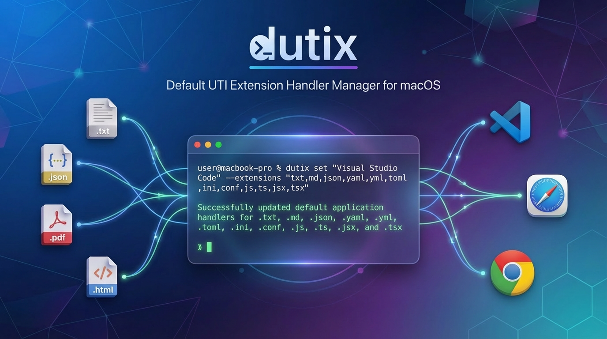
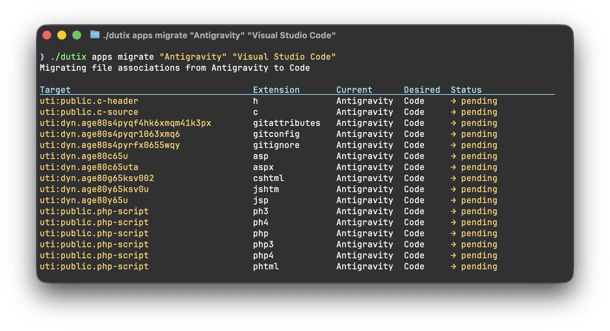

# dutix

[](https://github.com/jackchuka/dutix/actions/workflows/test.yml)
[](https://github.com/jackchuka/dutix/releases)
[](LICENSE)



**dutix** (Default UTI eXtension handler manager) is a command-line tool for managing default application handlers for file types, UTIs (Uniform Type Identifiers), and URL schemes on macOS.

## Features

- 🎯 Set default applications for file extensions, UTIs, and URL schemes
- 🔄 Migrate all file associations from one app to another
- 📋 List and inspect installed applications and their capabilities
- 🔍 Query current default handlers for any file type or URL scheme
- 🛡️ Safe operations with preview, confirmation, and dry-run modes
- 📊 Multiple output formats (table, JSON, YAML)
- 🚀 Fast native macOS integration



## Requirements

- macOS 12.0 (Monterey) or later
- Go 1.27 or later (for building from source)

## Installation

### Homebrew

```bash
brew install jackchuka/tap/dutix
```

### From Source

```bash
# Go install
go install github.com/jackchuka/dutix/cmd/dutix@latest

# Clone and build
git clone https://github.com/jackchuka/dutix.git
cd dutix
go build -o dutix ./cmd/dutix/
```

## Quick Start

```bash
# Set VS Code as default for text files
dutix set "Visual Studio Code" --extensions txt,md,json

# Check what handles .txt files
dutix targets show txt

# Migrate all file associations from one app to another
dutix apps migrate TextEdit "Visual Studio Code"

# List all installed applications
dutix apps list
```

## Usage

### Global Flags

Available on all commands:

| Flag       | Short | Description                               |
| ---------- | ----- | ----------------------------------------- |
| `--debug`  | —     | Enable debug logging                      |
| `--quiet`  | `-q`  | Suppress non-essential output             |
| `--output` | `-o`  | Output format: `table`, `json`, or `yaml` |

### Commands

#### `dutix set <app> [flags]`

Set default application for file extensions, UTIs, or URL schemes.

`<app>` can be an application name (or a substring of its name or path), a bundle identifier, or a path to an `.app` bundle. See [Specifying the application](#specifying-the-application).

**Flags:**

- `--extensions` - Comma-separated file extensions (e.g., `txt,md,json`)
- `--utis` - Comma-separated UTI identifiers (e.g., `public.plain-text`)
- `--schemes` - Comma-separated URL schemes (e.g., `http,https`)
- `--dry-run` - Preview changes without applying
- `--yes` - Skip confirmation prompt
- `--prune-others` - After applying, unregister other copies with the same bundle ID so defaults resolve to this one

**Examples:**

```bash
# Set default for file extensions
dutix set "Visual Studio Code" --extensions txt,md,json

# Set default for URL schemes
dutix set Safari --schemes http,https

# Preview changes first
dutix set TextEdit --extensions txt --dry-run

# Skip confirmation
dutix set Finder --extensions zip,tar --yes

# By bundle ID or bundle path
dutix set com.microsoft.VSCode --extensions md
dutix set ~/Applications/Foo.app --extensions md --prune-others
```

#### `dutix apps list [flags]`

List all installed applications.

**Flags:**

- `--filter` - Filter by name or path (case-insensitive)

**Examples:**

```bash
# List all applications
dutix apps list

# Find specific app
dutix apps list --filter "Visual"

# JSON output
dutix apps list --output json
```

#### `dutix apps show <app>`

Show detailed information about an application including supported file types and UTIs, and every registered copy of its bundle ID, starting with the one LaunchServices prefers.

**Examples:**

```bash
dutix apps show "Visual Studio Code"
dutix apps show Safari --output json
dutix apps show com.apple.TextEdit
dutix apps show ~/Applications/Foo.app
```

#### `dutix apps migrate <from-app> <to-app> [flags]`

Migrate all file type associations from one application to another.

**Flags:**

- `--dry-run` - Preview migration without applying changes
- `--yes` - Skip confirmation prompt
- `--prune-others` - Same as for `dutix set`, applied to `<to-app>`

**Examples:**

```bash
# Preview migration
dutix apps migrate TextEdit "Visual Studio Code" --dry-run

# Migrate with confirmation
dutix apps migrate TextEdit "Visual Studio Code"

# Auto-migrate without prompts
dutix apps migrate "Old App" "New App" --yes
```

#### `dutix targets show <target>`

Show current default handler for a file extension, UTI, or URL scheme.

The command automatically detects the target type:

- Extensions: `txt`, `json`, `pdf`
- UTIs: `public.plain-text`, `public.json`
- Schemes: `http`, `https`, `mailto`

**Examples:**

```bash
# Check file extension
dutix targets show txt

# Check UTI
dutix targets show public.plain-text

# Check URL scheme
dutix targets show http
```

#### `dutix targets list [pattern]`

List file extensions discovered across all installed applications, along with the UTI each extension resolves to and the current default application for that UTI.

An optional pattern filters extensions by case-insensitive substring.

**Examples:**

```bash
# List all discovered extensions
dutix targets list

# Filter by substring
dutix targets list txt

# Machine-readable output
dutix targets list --output json --quiet
```

#### `dutix version`

Display version information including git commit and build date.

```bash
dutix version
```

## Common Use Cases

### Setting Up a New Code Editor

```bash
# Set VS Code as default for common development files
dutix set "Visual Studio Code" --extensions \
  "txt,md,json,yaml,yml,toml,ini,conf,\
  js,ts,jsx,tsx,mjs,\
  py,rb,go,rs,java,c,cpp,h,hpp,\
  html,css,scss,sass"

# Preview first with dry-run
dutix set "VS Code" --extensions txt,md --dry-run
```

### Switching from One App to Another

```bash
# Migrate everything from TextEdit to VS Code
dutix apps migrate TextEdit "Visual Studio Code"

# Preview the migration first
dutix apps migrate Safari Chrome --dry-run
```

### Setting Default Web Browser

```bash
# Set Safari as default browser
dutix set Safari --schemes http,ftp,ftps

# Set Chrome
dutix set "Google Chrome" --schemes http
```

### Checking Current Defaults

```bash
# What opens .txt files?
dutix targets show txt

# What opens HTTP links?
dutix targets show http

# Get JSON output for scripting
dutix targets show txt --output json --quiet
```

### Finding App Capabilities

```bash
# See what file types an app supports
dutix apps show "Visual Studio Code"

# Find apps by name
dutix apps list --filter code

# Get machine-readable output
dutix apps show Safari --output json
```

### Specifying the application

Every command that takes an application (`set`, `apps show`, `apps migrate`) resolves it the same way:

1. **Bundle path**: an argument containing `/`, starting with `~`, or ending in `.app`. dutix expands `~` and `~user`, makes the path absolute, and resolves symlinks. A symlinked bundle therefore resolves to the real bundle it points to, which is the path LaunchServices records. The bundle is used even if it isn't in `/Applications` and the app scan doesn't list it. If a path starting with `/`, `~`, `./` or `../` doesn't exist, dutix stops with an error and does not guess. Other arguments that don't exist as paths, such as `Utilities/Terminal` or a bare `Foo.app`, fall back to the other two forms.
2. **Bundle ID**, e.g. `com.microsoft.VSCode`. This resolves to the copy LaunchServices currently prefers.
3. **Name**: a case-insensitive substring of an app's name or path, as before.

### When several copies share a bundle ID

macOS stores defaults by **bundle ID**, not by path. When several registered copies share a bundle ID, defaults and file opens resolve to the copy with the highest `CFBundleVersion`. The version is compared component by component as numbers. Ties are broken by path order. A copy you didn't pick can therefore end up handling your files, even right after `dutix set`.

However `<app>` is given, `dutix set` and `dutix apps migrate` do the following:

- **Registration**: if the app isn't registered with LaunchServices yet, it is registered before applying (`LSRegisterURL`).
- **`--prune-others`**: after applying, every other registered copy of the bundle ID is unregistered (`lsregister -u`), so the chosen copy wins. The preview lists the copies that will be removed.
- **Warnings**: dutix warns before and after applying if another copy still outranks the given path.

```bash
dutix set ~/Applications/Foo.app --extensions md,txt --prune-others --yes
```

A target is **unchanged** when its current default is already the app's bundle ID, even if a different copy currently opens it, for example after a rebuild that only moved the app to a new path. dutix then doesn't set it again, so macOS 26.4+ shows no confirmation dialog, and the plan marks it "unchanged (same bundle ID)" with a note naming the copy that currently opens it. Registering and `--prune-others` still run, which makes the chosen copy the one that opens it.

Pruning happens after applying, not before, because LaunchServices saves registration changes some seconds after they're made, and setting a default by extension restarts `lsd`, which drops unsaved changes. Measured on macOS 27.2, unregistering right after that restart is saved. Pass all of an app's targets in one `dutix set` call: a second call for the same app within a few seconds can restart `lsd` again before the first call's pruning is saved.

An unregistered copy that is still on disk may be registered again later, so run the command again if defaults drift. Use `dutix apps show <path>` to see which copy defaults resolve to. LaunchServices ignores apps in temporary directories (`/tmp`, `/private/var/folders`), so paths there can't win.

## Output Formats

### Table (Default)

Human-readable formatted tables:

```bash
dutix apps list
```

### JSON

Machine-parseable JSON output:

```bash
dutix apps list --output json
dutix targets show txt --output json | jq '.defaultApp'
```

### YAML

Structured YAML output:

```bash
dutix apps show "Visual Studio Code" --output yaml
```

## Development

### Project Structure

```
dutix/
├── cmd/dutix/           # Application entry point
├── internal/
│   ├── cli/            # CLI commands and subcommands
│   ├── domain/         # Business logic (planner, applier)
│   ├── formatter/      # Output formatters (table, JSON, YAML)
│   ├── logger/         # Logging utilities
│   └── macos/          # macOS bridge layer
```

### Build Commands

```bash
export CGO_ENABLED=1

# Build
go build -o dutix ./cmd/dutix/

# Test
go test ./...

# Lint
golangci-lint run ./...

# Generate mocks
go generate ./...
```

## How It Works

dutix relies on [macos-apphandlers-bridge](https://github.com/jackchuka/macos-apphandlers-bridge) to interface with macOS AppKit APIs for querying and setting default application handlers.

The tool uses a three-phase approach:

1. **Plan** - Resolves targets and queries current defaults
2. **Preview** - Shows what will change before applying
3. **Apply** - Makes the changes to system defaults

## Known Limitations

- Some system-protected defaults (like http) may require user confirmation in System Settings
- Changes to certain defaults may not be reflected immediately in all applications
- Requires running as the logged-in user (not sandboxed)
- Some system-internal UTIs are automatically filtered out during migration
- `public.html` UTI cannot be set programmatically and is automatically skipped
- Extensions not declared by any installed application resolve to dynamic (`dyn.*`) UTIs. dutix sets these by extension, writing the same LaunchServices entry as Finder's "Get Info → Open with → Change All…" and restarting `lsd`. This entry format is undocumented by Apple and may change in future macOS releases. Passing a `dyn.*` UTI directly via `--utis` is skipped; use `--extensions` instead
- A default set by extension only applies while no installed app declares that extension. Once an app declares it (e.g. installing an editor that exports a type for `.tf`), macOS resolves the extension to that app's UTI and ignores the extension-based default; run `dutix set` again to set the new UTI

## License

[MIT License](LICENSE)

## Contributing

Contributions welcome! See [docs/DEVELOPMENT.md](docs/DEVELOPMENT.md) for development guidelines.

## Credits

Inspired by:

- [duti](https://github.com/moretension/duti) - Command-line default handler manager

Built with:

- [Cobra](https://github.com/spf13/cobra) - CLI framework
- [tablewriter](https://github.com/rodaine/table) - Table formatting
- [macos-apphandlers-bridge](https://github.com/jackchuka/macos-apphandlers-bridge) - macOS integration
